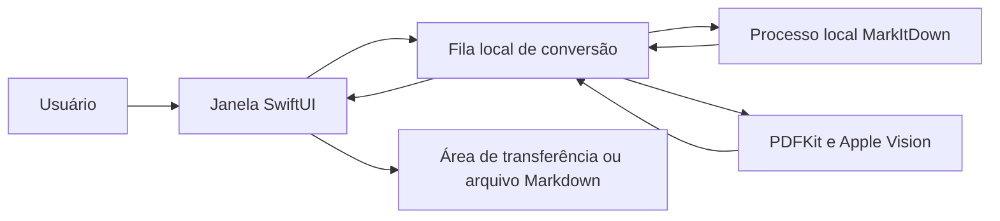

# MarkItDown para macOS — design técnico e de interface

## Overview

O [MVP](PRODUCT.md) usa uma janela de trabalho com lista de arquivos e área de leitura. O resultado é o centro da interface. A fila mantém o contexto quando há vários documentos, e as ações de cópia e exportação atuam sobre a seleção atual.

## Colors

Usar superfícies, separadores e cores semânticas do macOS nos modos claro e escuro. A cor de destaque do sistema identifica seleção, foco e ações principais. Estados trazem texto e, quando útil, um símbolo do sistema. Validar contraste de texto normal de pelo menos 4,5:1 nos dois temas.

## Typography

Usar a tipografia do sistema em títulos, nomes de arquivo, ações e avisos. Reservar a fonte monoespaçada para o Markdown. Permitir seleção, rolagem e quebra visual de linhas sem alterar o conteúdo copiado ou salvo.

## Layout

Janela redimensionável com barra de ferramentas e divisor nativo. A lista à esquerda começa com cerca de 250 pt e mostra nome completo na descrição acessível. O painel à direita mantém o nome do arquivo, seu estado e as ações do resultado junto ao conteúdo. Usar espaçamento de 8, 16 e 24 pt onde houver composição própria. Verificar a janela mínima com nomes longos, avisos em várias linhas e documentos extensos.

| Situação | Comportamento |
| --- | --- |
| Sem arquivos | Mostrar **Adicionar arquivos…**, opção de arrastar e formatos aceitos. Após a primeira importação, a janela continua aceitando arquivos arrastados. |
| Em fila ou convertendo | Exibir estado na linha. Para OCR em PDF, mostrar a página atual e o total. Usar progresso indeterminado nas etapas sem medição e mostrar **Cancelar** para o item ativo. |
| Concluído | Mostrar Markdown selecionável e habilitar **Copiar Markdown** e **Salvar Markdown…**. Quando houve OCR, informar no painel. |
| Concluído com avisos | Mostrar quais páginas ficaram sem resultado. Manter o resultado parcial disponível para cópia e exportação. |
| Falhou ou cancelado | Mostrar a causa em linguagem direta no item afetado e manter a lista navegável. |

## Components

- **Barra de ferramentas e menus.** **Adicionar arquivos…** (`⌘O`) abre o seletor. **Salvar Markdown…** (`⌘S`) abre o painel nativo quando há resultado. **Copiar Markdown** copia o resultado integral. `⌘C` continua disponível para copiar uma seleção de texto.
- **Lista.** Seleção e navegação por teclado. Cada linha anuncia nome e estado no VoiceOver. A atualização do progresso preserva seleção e foco. O estado final é anunciado sem interromper a leitura de outro item.
- **Painel do resultado.** Usar texto selecionável, com avisos próximos ao conteúdo afetado. A exportação usa o painel nativo do sistema. As transições seguem a preferência de redução de movimento.

## Arquitetura

| Componente | Responsabilidade |
| --- | --- |
| Janela SwiftUI | Importação, seleção, progresso e apresentação dos resultados. Usa as interfaces nativas de seleção e salvamento. |
| Fila local | Identifica cada item, executa uma conversão por vez fora da thread da interface e encaminha pelo tipo validado. Publica estado, Markdown e avisos por item. |
| Processo MarkItDown | Usa a API `convert_local()` para Office e PDF textual, com plugins desabilitados e dependências empacotadas para os formatos oferecidos. Recebe o caminho como argumento separado, sem shell. Retorna Markdown UTF-8 ou uma falha identificável. |
| PDFKit e Vision | PDFKit inspeciona e rasteriza páginas conforme a rota do PDF. Vision extrai texto das páginas sem camada textual utilizável e de imagens avulsas, localmente. |
| Exportação | Copia o texto integral ou grava em UTF-8 de forma atômica no destino escolhido, após confirmação de substituição quando aplicável. |

### PDFs e OCR

PDFKit inspeciona o texto de cada página. Para o MVP, uma página sem caracteres alfanuméricos na camada de texto segue para OCR. PDFs com camada textual utilizável em todas as páginas seguem inteiros para o MarkItDown. Em PDFs escaneados ou mistos, montar a saída em ordem, com cabeçalhos `## Página N`, texto extraído pelo PDFKit nas páginas textuais e resultado do Vision nas demais. A ordenação do OCR é aproximada e deve ser verificada no corpus de aceitação. Se uma página ficar sem texto, registrar seu número nos avisos. Nas páginas que combinam texto nativo e imagens, vale o texto da camada textual.

### Operação e falhas

- A fila mantém `Em fila`, `Convertendo`, `Concluído`, `Concluído com avisos`, `Falhou` e `Cancelado`. Cada resultado pertence à identidade da linha, inclusive para arquivos com nomes iguais.
- Cancelar encerra o subprocesso quando aplicável, ou interrompe o OCR entre páginas e descarta retornos pendentes. A fila só inicia o item seguinte quando o trabalho ativo terminou ou foi encerrado. Uma resposta tardia não publica resultado cancelado.
- A importação dá acesso somente aos arquivos escolhidos e a exportação somente ao destino concedido pelo sistema. O build deve verificar se o subprocesso empacotado consegue ler a entrada sob essas permissões. Se precisar de cópia temporária privada, ela deve ser removida após sucesso, falha ou cancelamento.
- Separar Markdown e diagnóstico. Erros mostrados ao usuário indicam o próximo passo quando houver recuperação. Diagnósticos omitem conteúdo, caminhos completos e credenciais. A saída é apresentada como texto local sem carregar recursos remotos.

### Verificação prevista

Usar arquivos sintéticos para validar roteamento, estrutura representativa, OCR, cancelamento, colisão de nomes e falha parcial. Testar foco e VoiceOver, os dois temas, a janela mínima e a redução de movimento. O smoke test abre o `.app` empacotado e percorre importação, conversão e exportação com a rede desligada. A escolha do empacotador e a matriz macOS dependem dessa prova.

### Referências

- [API local no checkout do MarkItDown](packages/markitdown/src/markitdown/_markitdown.py)
- [Apple Vision — reconhecimento de texto no dispositivo](https://developer.apple.com/documentation/vision/recognizing-text-in-images)
- [Apple Human Interface Guidelines — macOS](https://developer.apple.com/design/human-interface-guidelines/designing-for-macos)
