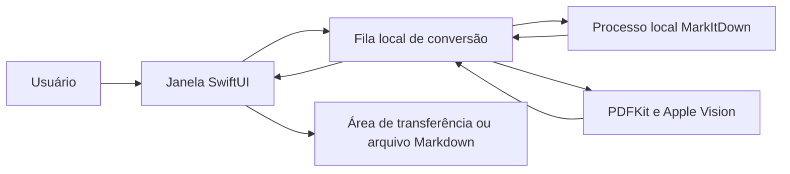

# MarkItDown para macOS — design técnico e de interface

## Overview

O [MVP](PRODUCT.md) usa uma janela de trabalho com lista de arquivos e área de leitura. O resultado é o centro da interface. A fila mantém o contexto quando há vários documentos, e as ações de cópia e exportação atuam sobre a seleção atual.

## Colors

Usar superfícies, separadores e cores semânticas do macOS nos modos claro e escuro. A cor de destaque do sistema identifica seleção, foco e ações principais. Estados trazem texto e, quando útil, um símbolo do sistema. Validar contraste de texto normal de pelo menos 4,5:1 nos dois temas.

## Typography

Usar a tipografia do sistema em títulos, nomes de arquivo, ações e avisos. Reservar a fonte monoespaçada para o Markdown. Permitir seleção, rolagem e quebra visual de linhas sem alterar o conteúdo copiado ou salvo.

## Layout

Janela redimensionável com barra de ferramentas e divisor nativo. Usar 960 × 640 pt como referência inicial, 720 × 480 pt como referência mínima e cerca de 250 pt para a lista. O nome completo fica disponível na descrição acessível. Usar espaçamento de 8, 16 e 24 pt na composição própria. Na menor janela, o painel faz quebra de linha e rola sem esconder as ações.

```text
MarkItDown                         [Adicionar arquivos… ⌘O]
─────────────────────┬────────────────────────────────────────
Arquivos             │ ata-reunião.pdf
› ata-reunião.pdf    │ Concluído com avisos
  Com avisos         │ OCR aplicado. Página 3 sem texto.
                     │ [Copiar Markdown] [Salvar Markdown…]
  recibo.jpg         ├────────────────────────────────────────
  Convertendo        │ ## Página 1
  [Cancelar]         │ Ata da reunião
                     │
  orçamento.xlsx     │ ## Página 2
  Em fila            │ Lista de participantes
```

| Situação | Comportamento |
| --- | --- |
| Sem arquivos | Mostrar **Adicionar arquivos…**, opção de arrastar e formatos aceitos. Após a primeira importação, a janela continua aceitando arquivos arrastados. |
| Em fila ou convertendo | Exibir estado na linha. Para OCR em PDF, usar **Lendo página N de M**. Nas demais etapas sem medição, usar progresso indeterminado. **Cancelar** aparece na linha ativa e pode ser acionado enquanto outro resultado está selecionado. |
| Concluído | Mostrar Markdown selecionável e habilitar **Copiar Markdown** e **Salvar Markdown…**. Quando houve OCR, informar no painel. |
| Concluído com avisos | Mostrar quais páginas ficaram sem resultado. Manter o resultado parcial disponível para cópia e exportação. |
| Falhou ou cancelado | Mostrar a causa em linguagem direta no item selecionado e manter a lista navegável. Para PDF protegido, orientar a adicionar uma cópia desbloqueada. Para ausência de texto, exibir **Nenhum texto reconhecido**. |

## Components

- **Barra de ferramentas e menus.** **Adicionar arquivos…** (`⌘O`) abre o seletor. **Salvar Markdown…** (`⌘S`) abre o painel nativo quando há resultado. **Copiar Markdown** copia o resultado integral e confirma a ação junto ao botão. `⌘C` continua disponível para copiar uma seleção de texto.
- **Lista.** Selecionar o primeiro item quando a lista estava vazia. Novas importações e atualizações de progresso preservam seleção e foco. Cada linha anuncia nome e estado no VoiceOver. Para arquivos homônimos, exibir e anunciar o trecho da pasta de origem que diferencia as entradas. Anunciar a conclusão do item selecionado, sem deslocar o foco ou repetir cada página. A ação **Cancelar conversão** da linha ativa é acessível por teclado e VoiceOver.
- **Painel do resultado.** Usar texto selecionável, com avisos acima do Markdown. Ao abrir o painel de salvamento, vincular a ação ao resultado selecionado naquele momento. A confirmação de substituição identifica o destino. Ao concluir, mostrar confirmação junto à ação. Em falha de gravação, manter a saída disponível e permitir escolher outro destino. As transições respeitam a preferência de redução de movimento.

## Arquitetura



| Componente | Responsabilidade |
| --- | --- |
| Janela SwiftUI | Importação, seleção, progresso e apresentação dos resultados. Usa as interfaces nativas de seleção e salvamento. |
| Fila local | Identifica cada item, executa uma conversão por vez fora da thread da interface e encaminha pelo tipo validado. Publica estado, Markdown e avisos por item. |
| Processo MarkItDown | Usa a API `convert_local()` para Office e PDF textual, com plugins desabilitados e dependências empacotadas para os formatos oferecidos. Recebe o caminho como argumento separado, sem shell. Retorna Markdown UTF-8 ou uma falha identificável. |
| PDFKit e Vision | PDFKit inspeciona e rasteriza páginas conforme a rota do PDF. Vision extrai texto das páginas sem camada textual utilizável e de imagens avulsas, localmente. |
| Exportação | Copia o texto integral ou grava em UTF-8 de forma atômica no destino escolhido, após confirmação de substituição quando aplicável. |

### PDFs e OCR

PDFKit inspeciona o texto de cada página. Para o MVP, uma página sem caracteres alfanuméricos na camada de texto segue para OCR. PDFs com camada textual utilizável em todas as páginas seguem inteiros para o MarkItDown. Em PDFs escaneados ou mistos, montar a saída em ordem, com cabeçalhos `## Página N`, texto extraído pelo PDFKit nas páginas textuais e resultado do Vision nas demais. A ordenação do OCR é aproximada e deve ser verificada no corpus de aceitação. Se uma página ficar sem texto, registrar seu número nos avisos. Nas páginas que combinam texto nativo e imagens, vale o texto da camada textual.

### Operação e falhas

- A fila mantém `Em fila`, `Convertendo`, `Cancelando…`, `Concluído`, `Concluído com avisos`, `Falhou` e `Cancelado`. Cada resultado pertence à identidade da linha, inclusive para arquivos com nomes iguais.
- Cancelar desabilita novos pedidos para o item e mostra **Cancelando…** enquanto o trabalho encerra. Sinalizar o subprocesso quando aplicável ou interromper o OCR entre páginas. A fila só inicia o próximo item após o encerramento do trabalho ativo. Descartar retornos tardios do item cancelado.
- Confirmar que a entrada corresponde a um formato do MVP antes de chamar o conversor. Associar entradas rejeitadas ao nome do arquivo na fila. Tratar uma falha recuperável de página como aviso se houver texto em outras páginas. Em PDF escaneado ou misto, verificar se houve texto extraído antes de montar cabeçalhos, pois os cabeçalhos por si só não constituem resultado.
- A importação dá acesso somente aos arquivos escolhidos e a exportação somente ao destino concedido pelo sistema. O build deve verificar se o subprocesso empacotado consegue ler a entrada sob essas permissões. Se precisar de cópia temporária privada, ela deve ser removida após sucesso, falha ou cancelamento.
- Separar Markdown e diagnóstico. Erros mostrados ao usuário indicam o próximo passo quando houver recuperação. Diagnósticos omitem conteúdo, caminhos completos e credenciais. A saída é apresentada como texto local sem carregar recursos remotos.

### Verificação prevista

Usar arquivos sintéticos para validar roteamento, estrutura representativa, OCR, cancelamento, colisão de nomes e falha parcial. Testar estados vazio, ativo, concluído, parcial e com erro nas dimensões inicial e mínima, nos dois temas. Verificar também foco, VoiceOver, redução de movimento e operação por teclado. O smoke test abre o `.app` empacotado e percorre importação, conversão e exportação com a rede desligada. Registrar a versão do macOS e a arquitetura desse teste conforme a [spec](PRODUCT.md#validação-da-distribuição) (validado em macOS `26.6.2` build `25G83`, arquitetura `arm64`).

### Referências

- [API local no checkout do MarkItDown](packages/markitdown/src/markitdown/_markitdown.py)
- [Apple Vision — reconhecimento de texto no dispositivo](https://developer.apple.com/documentation/vision/recognizing-text-in-images)
- [Apple Human Interface Guidelines — macOS](https://developer.apple.com/design/human-interface-guidelines/designing-for-macos)
